# Gmem 技术方案 v1

> 状态：设计文档 v1.2。工作区当前只有 `README.md`，`go.mod` 不存在，**尚未有任何实现**。本文的 LOC 与阈值均为待校准估算。
>
> 修订历史：v1.1 —— 实体抽取改为**必需 LLM、但 LLM 由主调方注入**（§3.1）、可视化首版改为**网络图**（§9）、本轮**不启动实现**（§12）；v1.2 —— LLMClient 保留**轻量 tool-calling**、循环与收敛由 Gmem 拥有（§3.2）；MCP 改为**配置优先、sampling 兜底**（§3.3）。

---

## 0. 决策台账

逐条翻译成工程约束：

| # | 决策 | 工程约束 | 位置 |
|---|---|---|---|
| D1 | 本体契约加在**召回侧** | 本体永不拒绝写入；只有召回时才做对齐、选路、判覆盖 | §5 |
| D2 | 需要**本地**提取/消歧/链接管线 | 管线本体在 Gmem 内，不依赖外部服务编排 | §3 §4 |
| D3 | 两种触发：自动 + Agent 调用 | 二者共享同一套原子 op，不允许两条代码路径 | §8 |
| D4 | 可视化要能**以网络图看实体与关系** | 首版即 Graph View；`gmem serve` 起本地 HTTP | §9 |
| D5 | 三接入：CLI / MCP / Go package | 同一接口面三层薄壳，方法名对齐主流五动词 | §10 |
| D6 | 双后端可迁移 | Phase 1 就定 Port 接口，SQLite 先落地，PG+pgvector 后接 | §11 |
| **D7** | 实体抽取**需要 LLM**，但 LLM 由**主调方 Agent** 承担 | `LLMClient` / `Extractor` 两层抽象；Gmem **不直连任何 LLM、不 import 任何 LLM SDK** | §3.1 |
| **D8** | CLI / MCP 无宿主 Agent | **未配置时走 sampling，已配置时用配置**；两者都无则显式降级并报告 | §3.3 |
| **D9** | 先不写代码 | 本轮只收敛设计；路线图保留但**不启动实现** | §12 |
| **D10** | LLMClient 保留**轻量 tool-calling**，支持多轮查询后再产出 | `Complete` 仍是单轮 primitive，**循环由 Gmem 拥有**，收敛由 Gmem 硬约束（§3.2） | §3.2 |
| **D11** | P4 做**内嵌前端** | 允许引入前端库与构建链（Node 作为**开发期**依赖可以接受）；产物 `//go:embed` 进二进制，运行时零外部依赖 | §9 |
| **D12** | 双时态采用**系统时间版本化**（B-4/B-5 裁决） | `memories`/`edges` 主键改为 `(id, version)`；`Update` 插新版并把旧版置 `t_expired`；默认读当前版本，`as_of` 按版本区间选；FTS 索引所有版本 | §2 |
| **D13** | 只有**内容承载字段**变更才产生新版本 | `recall_count` / `last_recalled_at` 等运营计数**就地更新**，不得版本化（否则召回即版本爆炸）；FTS 也必须按 `(id, version)` 索引并携带版本，否则 `as_of` 词法召回静默漏旧版 | §2 |

**三条核心取舍，都必须先认下来：**

1. **D1 选召回侧**，意味着 Gmem 放弃了“从源头保证数据干净”。换来的是——不会出现 CortexDB 那种“strict 模式必须给自己的抽取器开豁免口”的妥协。这是自觉的交换，不是遗漏。
2. **D7 让 LLM 外置**，意味着 Gmem 的能力**上限由宿主决定**。换来的是零 LLM SDK 依赖、零密钥管理、可离线、可测试。这和 CortexDB 的 `CortexDB never imports an LLM SDK` 是同一原则。
3. **D10 引入 tool-calling，意味着抽取从“一次生成”变成“一个可能多轮的过程”**。代价是延迟与成本上限变成变量。换来的是多跳关系能抽对。**收敛因此从“希望模型自觉”变成 Gmem 必须提供的硬保证**——这是 §3.2 存在的理由。

---

## 1. 分层架构

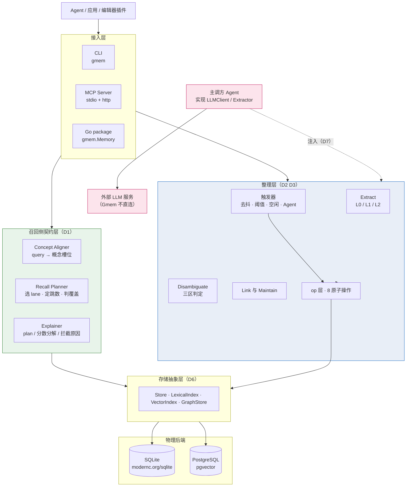

**读法**：绿色是召回侧契约层，蓝色是整理层。两层**都只和 Port 说话**，不直接碰 SQL——这是 D6 成立的前提。粉色是**外部提供方**：LLM 属于主调方，Gmem 只定义契约、组织调用、校验输出，不持有密钥也不发请求——这是 D7。

---

## 2. 数据模型

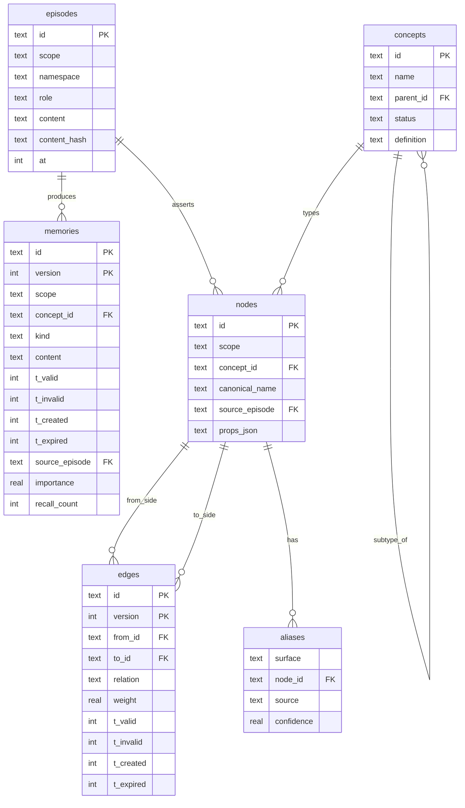

**四处刻意的设计：**

1. **`episodes` 是不可变的事实来源**（Zep 的底线）。任何 `memories`/`nodes` 都能溯源回 episode，重建得出来。因此 `nodes` 也必须有 `source_episode`。
2. **两个时间轴，语义必须严格区分**（D12 裁决，见下）：
   - **世界时间** `t_valid` / `t_invalid`：这个事实**在现实世界中**何时成立。矛盾发生 → 只置 `t_invalid`，**永不物理删除**。
   - **系统时间** `t_created` / `t_expired`：**系统何时知道/何时不再认为它是当前版本**。`Update` 不改行，而是**插入新版本并把旧版本置 `t_expired`**。
3. **版本化主键 `(id, version)`**：`id` 是用户可见的逻辑身份，`version` 从 1 递增。**默认读取 = 当前版本（`t_expired IS NULL`）**；`as_of` 选 `t_created ≤ as_of < t_expired` 的版本。这一条是 B-4 的裁决 —— 若不版本化，`t_created`/`t_expired` 就是两列死字段，双时态退化成单时态。
   - **什么才算新版本（D13）**：只有**内容承载字段**变化才生成新版本（`content`、`kind`、`concept_id`、`t_valid`、`t_invalid`、`source_episode`、`importance`）。**运营计数类字段（`recall_count`、`last_recalled_at`）一律不得产生版本**，它们应就地更新或被移出主表。否则每被召回一次就多一个版本，叠加 per-version FTS 会直接把库撑爆。
4. **`concepts.status` 是 D1 的关键**：`draft` / `certified` / `deprecated`。只有 `certified` 参与硬契约。这是让"本体不拒绝写入"能成立的机制——概念先以草稿累积，认证后才约束召回。

**派生索引**：`memories_fts`（FTS5 + bigram 列）、`vec_blob`（int8 量化快照）。二者都可从主表重建。

> **FTS 与版本的关系（B-5 裁决）**：FTS 索引**每一行的每个版本**，查询时 join 到 `memories(id, version)` 并按上述有效性规则过滤。因此 `memories_fts` 的主键语义是 `(id, version)` 而不是 `id`，`store.Hit` 必须能表达版本。代价是索引体积随版本数增长（配合 D13 后常见情况仅 1–2 版，可接受）；收益是 `as_of` 与词法检索可以组合，不会出现"回溯查询静默少了词法通道"。

> **范围隔离是 Port 契约的一部分**：`NeighborQuery` 等一切查询**必须带 `Scope` 且在后端强制过滤**。漏一个字段就是跨 scope 泄漏（review 实测曾出现 user→agent 的边），这不是性能问题而是隔离缺陷。

---

## 3. 提取管线（D2 D7 D8）

**实体抽取需要 LLM，但 LLM 由主调方提供。** Gmem 内部只定义契约、组织调用、校验输出；**不直连任何 LLM 服务，也不 import 任何 LLM SDK**。这条约束让「单体」与「有智能」同时成立。

三级管线，只有 L2 需要 LLM：

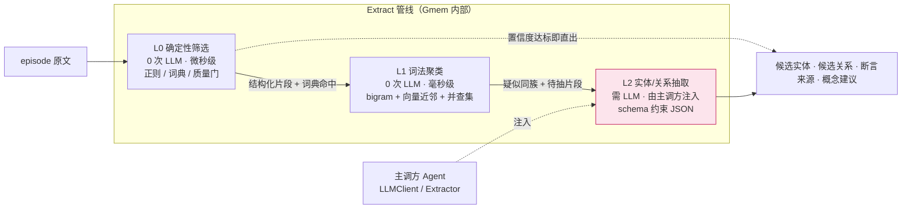

**L0 与 L1 不是用来替代 LLM 的，而是用来少给 LLM 喂垃圾**：L0 把明显不该进记忆的内容（过短、临时态、密钥）在零成本处拦掉；L1 把「可能指同一实体」的片段归簇，让 L2 **一次调用处理一簇而不是一条**。这两级是成本控制，不是能力降级。

### L0 确定性提取（0 次 LLM）

| 模式 | 规则 | 产出 |
|---|---|---|
| 结构化 | 代码块、URL、文件路径、版本号、日期、数字+单位 | literal 节点 |
| 词典 | 命中 `aliases` 表 + `concepts.name` | entity 引用（最高置信） |
| 定义句 | `X 是 Y` / `X 指 Y` / `X：Y` / `X means Y` | concept 候选 + definition |
| 偏好句 | `我(更)?(喜欢\|偏好\|倾向\|不要\|避免\|别) X` | `preference` 类型 memory |
| 决策句 | `决定\|选型\|定为\|改用\|弃用` | `decision` 类型 memory |
| 关系三元组 | `<主语> <动词短语> <宾语>`，动词映射 relation 白名单 | edge 候选 |
| 时效信号 | `待定\|等确认\|明天\|下周\|临时` | `ephemeral: true` 标记 |

⚠️ 最后一行来自 A-MEM 的写入侧质量门思路：**先便宜地拒掉或降级**，别把临时状态当长期记忆。同样设长度下限（<10 字符拒写）。

### L1 词法聚类（0 次 LLM）

同 scope 内，未消歧节点两两做 bigram/BM25 + 向量近邻，取 top-K，用并查集产出「疑似同一实体」簇，交给 §4 消歧。**只产生候选，不做决定。**

### L2 实体抽取（必需，LLM 由主调方注入）

L2 只处理 L0/L1 交出的片段，输入是「一个簇 + 已有实体候选」，输出是 schema 约束的 JSON。硬约束：

- **输出必须是 JSON** 且符合 Gmem 给出的 schema；解析失败按 §3.1 的重试策略处理，**不静默丢弃**
- **单批预算上限**（token 数与条数），超限截断而非失败
- **超时可取消**，一律接 `context.Context`
- **可关闭**——`Extractor: NoopExtractor{}` 时退化为 L0+L1，功能可跑但抽取质量下降，且必须在 `Degraded` 里显式报告

---

### 3.1 LLM 注入契约（D7）

分两层抽象：宿主可以只给一个模型，也可以整段替换抽取逻辑。

```go
// 第一层：单轮模型调用 primitive。宿主实现这一个方法，Gmem 就能跑 L2。
// 刻意保持“单轮”：没有 streaming，也不由宿主自己跑循环。
// tool-calling 的“循环”由 Gmem 拥有（见 §3.2），这样收敛才能被硬保证。
type LLMClient interface {
    Complete(ctx context.Context, req LLMRequest) (LLMResponse, error)
}

type LLMRequest struct {
    System      string          // Gmem 提供的抽取指令（宿主可覆盖）
    User        string          // 待抽片段 + 已知实体候选
    JSONSchema  json.RawMessage // 强约束输出形状；宿主应尽量用结构化输出能力
    Tools       []ToolSpec      // D10：只读查询工具声明；为空则纯单轮
    MaxTokens   int
    Temperature float32         // Gmem 默认 0，抽取任务不需要随机性
}

type LLMResponse struct {
    Text      string     // 期望是符合 JSONSchema 的 JSON
    ToolCalls []ToolCall // D10：模型想先查点什么；为空则本次已是终稿
    Usage     LLMUsage
    Model     string
    Truncated bool
}
```

```go
// 第二层：整段可替换的抽取器。默认实现 LLMExtractor 建在 LLMClient 之上。
// 宿主若要接入自己的 agent 框架（例如把抽取交给主 agent 的 tool 调用），
// 实现这个接口即可，Gmem 不关心背后有没有 LLM。
type Extractor interface {
    Extract(ctx context.Context, req ExtractRequest) (ExtractResult, error)
}

type ExtractRequest struct {
    Episode  RawEpisode
    Clusters []Cluster     // L1 给出的疑似同簇
    Known    []EntityBrief // 当前 scope 已有实体，供消歧参考
    Budget   Budget
}

type ExtractResult struct {
    Entities  []ExtractedEntity
    Relations []ExtractedRelation
    Concepts  []ConceptHint // 概念建议，落为 draft
    Degraded  []string
}
```

**三种接线方式**（宿主按自己的形态选）：

| 宿主形态 | 接线方式 |
|---|---|
| 已有自己的 LLM 客户端 | 实现 `LLMClient`，复用默认 `LLMExtractor` |
| 想把抽取交给主 agent 的 tool 循环 | 实现 `Extractor`，循环与收敛全由自己负责 |
| 完全离线 / 单元测试 | `NoopExtractor{}`，退化到 L0+L1 |

**注意两者的责任差异**：实现 `LLMClient` 时，**循环、预算、收敛都由 Gmem 管**（§3.2），宿主只管“给我这一轮的输出”；实现 `Extractor` 时，宿主接管全部，包括收敛——**Gmem 不再能保证它不死循环**，但会通过 `context` 超时强制中断。

**Gmem 的责任边界**（写死，避免越界）：

1. 提供提示模板与 JSON schema，但**允许宿主整段覆盖**
2. 校验响应：JSON 可解析、字段合法、实体名非空、关系两端都在结果或已知实体中
3. 解析失败**重试 1 次**（附错误说明的修复式重试），仍失败则降级并记入 `Degraded`，**不抛出**
4. 记账：token 用量、模型名、耗时，随每次抽取写入 `audit_log`
5. **绝不保存 API key，绝不发请求**

**测试替身**：`FakeLLM{Responses []string}` 必须随库发布，让使用者的 CI 不依赖网络与密钥。它同时要能模拟**带 tool-call 的多轮序列**（第 N 轮返回 tool call、第 N+1 轮返回终稿），否则 D10 的收敛逻辑无法被测。

---

### 3.2 轻量 tool-calling 与收敛保证（D10）

抽取多跳关系时，模型经常需要先查一步：“Alice 和 Apollo 之间已经有什么边？”“scope 里是否已有叫‘张伟’的实体？”——不给它查询能力，它就只能猜。这就是要 tool-calling 的理由。

**但它必须不能变成开放式 agent 循环。** 因此下面这些硬边界全部默认生效：

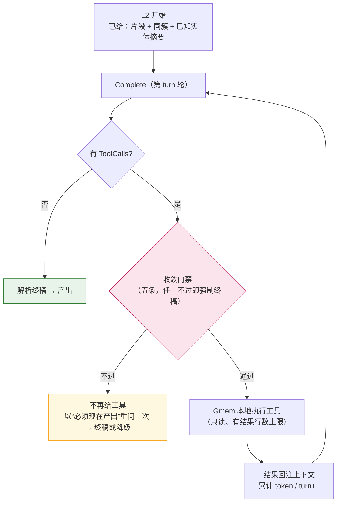

**五条收敛门禁**（全部默认开启，均可配置）：

| # | 门禁 | 默认 | 不过时的行为 |
|---|---|---|---|
| G1 | `MaxTurns` | **3** | 强制终稿 |
| G2 | 累计 token 预算 | 由 `Budget` 定 | 强制终稿 |
| G3 | **同 query 重复** | 比较归一化后字符串 | 直接拒这一跳，不再回注 |
| G4 | **无进展检测** | 连续 2 轮工具结果为空/无新增节点 | 强制终稿 |
| G5 | 墙钟超时 | `context` deadline（默认 30s） | 中断并降级 |

**工具面刻意极小：三个只读查询，全部有结果上限。**

| 工具 | 参数 | 返回 | 行数上限 |
|---|---|---|---|
| `lookup_entity` | `name`, `concept?` | 候选实体 + alias + 置信度 | 10 |
| `neighbors` | `node_id`, `relation?`, `hops≤1` | 邻接边（含已失效边与有效期） | 30 |
| `search_memories` | `query`, `k≤5` | 相关记忆摘要 | 5 |

三条隐性约束，全是防循环的：

1. **`hops` 上限固定 1** —— 模型不能自己发起多跳遍历，它必须一步步走。这让 G1 的 turn 计数真正能起作用。
2. **无写工具** —— 工具面里没有任何 `create` / `update`，模型无法在半途改动库而影响自己的后续查询。
3. **返回带截断标记** —— 超上限时明确告诉模型“只给了前 N 条”，避免它误以为查完了。

**为什么循环必须归 Gmem 而不是宿主**：收敛是五个计数器的联合判断（turn / token / 重复 / 无进展 / 时间），这些计数器只有**拥有循环的一方**才能维护。若循环交给宿主，Gmem 就只能祈祷它别死循环，D10 的“确保收敛”就是空话。这是把 `Extractor` 与 `LLMClient` 分开的真正理由：**选 `LLMClient` 拿收敛保证，选 `Extractor` 拿完全自由。**

**收敛的测试必须是确定性的**：用 `FakeLLM` 编排出“永远返回 tool call”的序列，断言 Gmem 在恰好 3 轮后强制终稿、且**总调用次数 == MaxTurns + 1**。这条测试是 D10 唯一的验收依据。

---

### 3.3 CLI / MCP 的 LLM 配置（D8）

CLI 与 MCP 没有宿主 Agent，必须自己配。默认走 OpenAI 兼容端点（与 CortexDB 的 `CORTEXDB_EMBED_*` 同构）：

| 环境变量 | 含义 |
|---|---|
| `GMEM_LLM_BASE_URL` | OpenAI 兼容端点 |
| `GMEM_LLM_API_KEY` | 密钥 |
| `GMEM_LLM_MODEL` | 模型名 |
| `GMEM_LLM_MAX_TOKENS` / `GMEM_LLM_TIMEOUT` | 预算与超时 |
| `GMEM_EXTRACT_MODE` | `auto` / `l0_only` / `off` |

**未配置 `GMEM_LLM_BASE_URL` 时**：先尝试走 MCP sampling（若可用），仍不可用则降级并显式上报——`gmem doctor` 报 `extraction: degraded (L0 only)`，`recall` 结果带 `Degraded`。**绝不静默降级**——这是这条设计最容易出的事故。

#### MCP 特有的一条路：Sampling（作为**未配置时的兜底**）

MCP 协议本身就提供了「**服务器向客户端请求 LLM 生成**」的标准能力：服务端发 `sampling/createMessage`，**无需服务端持有任何 API key**。这与 D7 的哲学完全一致——LLM 始终在客户端（也就是宿主 Agent）那侧。

**优先级（D8）：配置优先，sampling 兜底。** 理由：显式配置代表使用者已经做了明确选择（模型、成本、合规），而 sampling 要依赖客户端能力和用户弹窗，行为不可预测——**只在“没交代过怎么办”的时候才去问客户端要模型**。

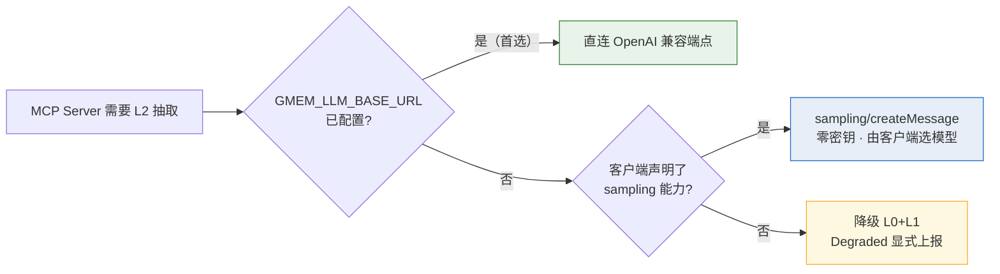

三个注意点：

1. **sampling 路径下，协议建议保留人在环路**（官方 spec 明确 SHOULD），一次抽取可能弹多个确认框。因此 sampling 路径下：批量写入按批弹一次（把整批的抽取提示合在一条 sampling 请求里），单条低价值写入**直接降级而不弹窗**。
2. **sampling 的模型偏好用优先级而非模型名**（`costPriority` / `speedPriority` / `intelligencePriority`），因为服务端不知道该客户端有什么模型。抽取任务建议 `intelligencePriority: 0.7`、`speedPriority: 0.3`。
3. **两条路径的行为必须一致**：同一个片段走配置或走 sampling，产出的 `ExtractResult` 形状、校验规则、降级语义完全相同。**差异只在“模型从哪来”，不能渗透到业务逻辑。** 这是双路径设计最容易腐化的地方。

---

## 4. 消歧管线（D2）

### 三区判定

信号是三元组，不是单一余弦：

```
s = w1 · cosine(emb(name+definition))
  + w2 · BM25(name, aliases)
  + w3 · 结构一致性(已有 relation 类型重叠度)
```

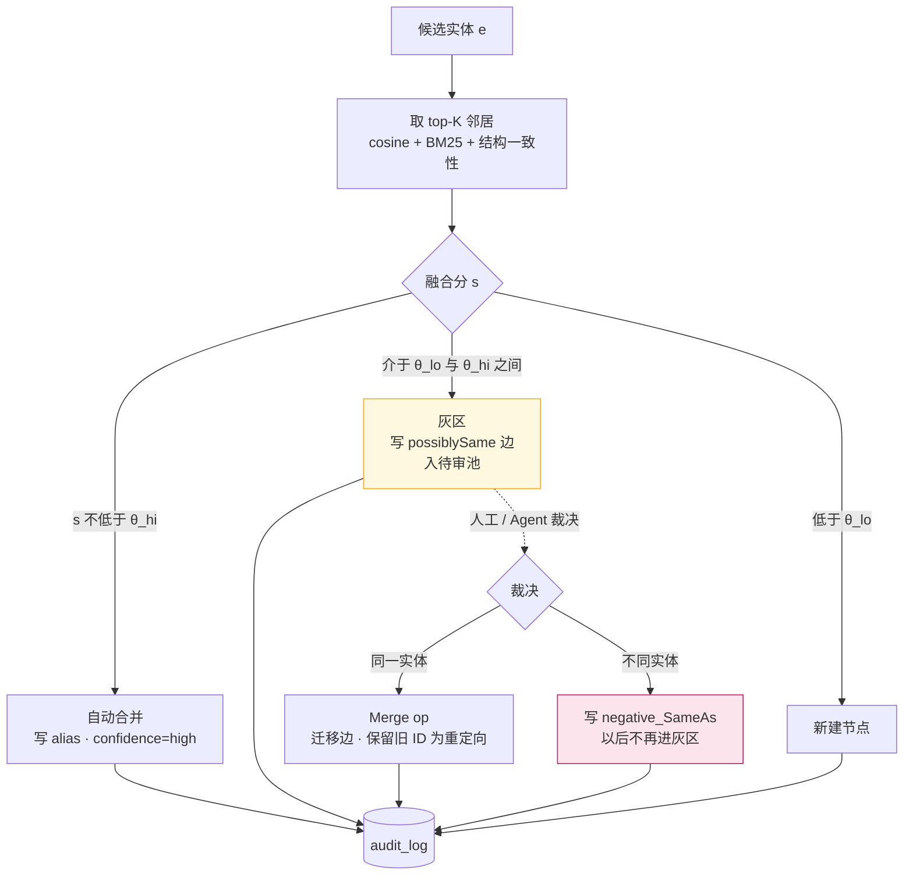

**三个必须做到的点：**

1. **θ_hi / θ_lo 是配置项，不是硬编码**。起点取 0.92 / 0.72（参考 A-MEM 的灰区设计），**必须用真实数据校准后再定死**。
2. **灰区绝不合并**。CortexDB 的做法值得照抄：`possiblySame` 链接 + 进待审池，而不是猜。误合并是记忆系统最难恢复的错误——两条事实混一起，事后无法拆开。
3. **`negative_SameAs` 是必需的**。没有它，"张三(A)"和"张三(B)"会反复进入灰区，每次都要人重新判一遍。

### 歧义爆炸的护栏

| 指标 | 阈值 | 动作 |
|---|---|---|
| 同 scope 节点数 / episode 数 | > 某比例 | 告警：抽取过碎 |
| 灰区待审积压 | > N 条 | 降级：暂停 L2，只跑 L0/L1 |
| 单节点 alias 数 | > M | 强制人工审，防"万能实体" |

---

## 5. 召回侧本体契约（D1 核心）

这是整份方案里最需要说清楚的一节。

### 五条规则

| # | 规则 | 反面（业界做法） |
|---|---|---|
| **R1** | 本体**不拒绝写入**，concept/entity 是"观察"不是"准入" | CortexDB strict 会拒写，故必须留豁免 |
| **R2** | 概念生命周期 `draft → certified → deprecated`，**只有 certified 参与硬契约** | 一次性大 schema，人肉维护跟不上 |
| **R3** | 召回**概念先行**：先对齐 → 再选 lane → 再**定向**扩展 | Graphiti 用盲 BFS 深度 3，噪声大 |
| **R4** | 覆盖不足返回 `insufficient` + 缺什么 | 普遍做法是低分硬答 |
| **R5** | 每次召回输出**可解释 plan** | 普遍只有分数，没有理由 |

### 完整时序

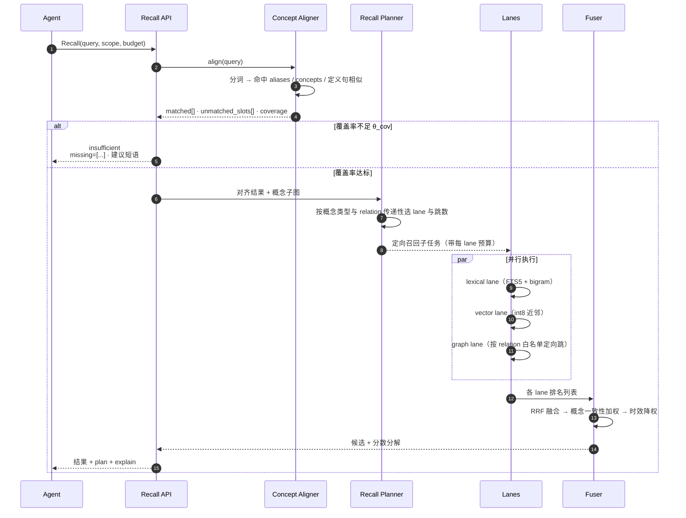

### R3 的落地：定向扩展 vs 盲 BFS

这是与 Graphiti 最大的分歧点，也是我认为收益最高的一个改进。

| relation | 传递性 | 允许跳数 | 理由 |
|---|---|---|---|
| `subtype_of` / `part_of` | 传递 | 3 | 抽象层级天然可传 |
| `depends_on` | 传递 | 3 | 依赖链有意义 |
| `works_at` | 非传递 | 1 | 两跳就到别人公司 |
| `owns` | 非传递 | 1 | 三跳全是无关资产 |
| `caused_by` | 传递 | 2 | 因果链过深会跑题 |

**关系类型上标注传递性，跳数由关系决定，不由全局常量决定。** Graphiti 的 `bfs_max_depth=3` 是全局参数，对所有边类型一视同仁——这是它结构上的一个弱点。

### lane 选择规则表

| 查询形态 | 选用 lane | 初始权重 |
|---|---|---|
| 概念全覆盖 + 有实体锚点 | graph + vector + lexical | 0.5 / 0.3 / 0.2 |
| 概念全覆盖 + 无实体锚点 | lexical + vector | 0.6 / 0.4 |
| 概念部分覆盖 | vector + lexical（graph 弱参与） | 0.5 / 0.4 / 0.1 |
| 纯字面 / 标识符 / 代码符号 | lexical only | 1.0 |
| 关系型问句（"谁用的什么"） | graph 主、vector 辅 | 0.7 / 0.3 |

⚠️ 权重是**起点**，需要用评测集回归，不要当成定论。

### R4：`insufficient` 的判定

```
coverage = Σ(matched_slot_weight) / Σ(all_slot_weight)

insufficient  ⟸  coverage < θ_cov  或  未对齐槽位里有「必需的实体槽」或「必需的关系槽」
```

返回体：

```go
type RecallResult struct {
    Status    RecallStatus   // ok | insufficient | degraded
    Items     []RecallItem
    Coverage  float64
    Missing   []MissingSlot  // 结构化：缺什么类型的东西
    Plan      *RecallPlan    // R5
    Degraded  []string       // 例如 "vector lane skipped: no embedder"
}
```

`Missing` 是 Auto-Ontology 的 `check_answerable` 搬到记忆场景：**"你问的『部署环境』这个维度我完全没有记录"** —— 这比返回三条低相关记忆有用得多。

---

## 6. 链接维护

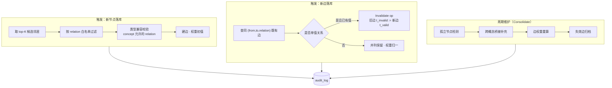

**边权重**（三项乘积，全部落库以便后续调参）：

```
w = log(1 + assert_count) × grade_factor × recency_decay(Δt)
```

> 这里有一个来自 LivingFeed 的实践：**把复合分的各分项都存下来，而不是只存总分**。这样系数可以靠 replay 重算，不必回头扫全库。代价是几列存储，收益是调参时不必重建数据。

---

## 7. 记忆生命周期

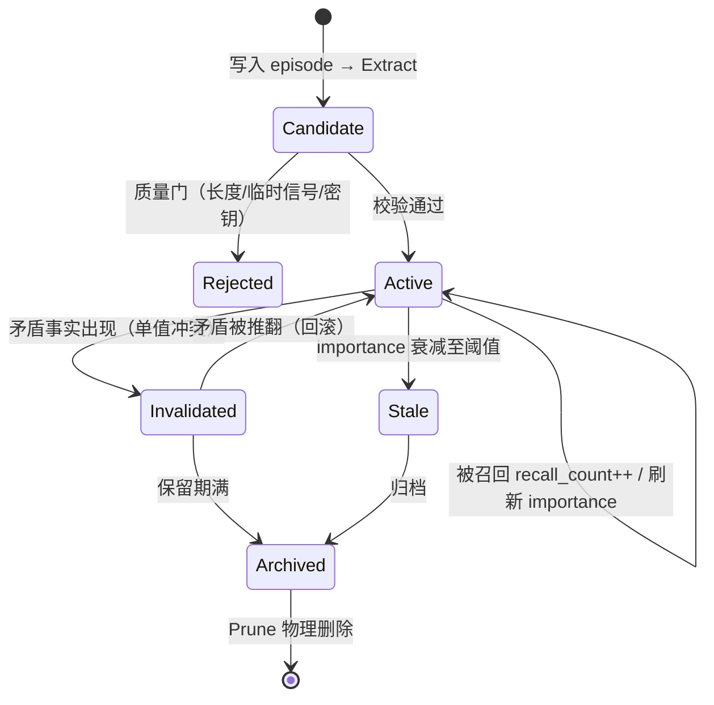

**四条纪律：**

1. **`Invalidated` 不等于删除**，仍可 `as_of` 时间回溯查询（Zep 语义）。
2. **`importance` 衰减是分项存储的**：`base × recency × access_boost × grade`，四项各存一列。
3. **`Prune` 是唯一的物理删除**，必须显式触发、必须留审计、且默认只在 `Archived` 上作用。
4. **`Rejected` 也落库**——"为什么没记住这条"同样是可回答的问题。

---

## 8. op 层：两种触发统一（D3）

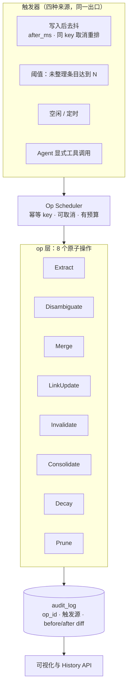

**这个设计的全部价值在于：自动触发和 Agent 调用，走的是同一套代码。**

业界现状是二选一——Letta/LangMem 的 hot-path tool，或者 Mem0/Letta 的后台隐式。两条路径分开写，会分别长出 bug，而且行为不可比。Gmem 把它们压缩成 op 的编排差异。

### op 契约

```go
type Op interface {
    Name() string
    Budget() Budget                              // tokens / duration / io
    Plan(ctx context.Context, tx *Tx) ([]Step, error)
    Apply(ctx context.Context, tx *Tx, s Step) (Diff, error)
}

type Trigger struct {
    Kind   TriggerKind    // after_write | threshold | idle | cron | agent
    Key    string         // 去抖键：scope 或 thread
    After  time.Duration  // 仅 after_write/idle
    Budget Budget
}
```

**幂等 key** = `hash(scope, op_name, 输入摘要)`。重跑安全。
**可取消** = 一律接 `context.Context`。Agent 打断时不留半截状态。
**去抖语义** = 直接照搬 LangMem 的 `ReflectionExecutor`：`submit(payload, after=N, key)`，同 key 新事件**取消并重排**。**等对话安静再固化，而不是每轮都跑** —— 这个细节决定成本量级。

### Agent 可调用的维护工具面

| op | Agent 工具 | 什么时候该由 Agent 主动调 |
|---|---|---|
| Extract | — | 不暴露（自动） |
| Disambiguate | `gmem_review_similar` | Agent 发现冲突时主动查疑似重复 |
| Merge | `gmem_merge` | Agent 确认两实体同一 |
| LinkUpdate | `gmem_link` / `gmem_unlink` | Agent 明确知道两个概念的关系 |
| Invalidate | `gmem_supersede` | Agent 主动宣布旧事实作废 |
| Consolidate | `gmem_consolidate` | Agent 被要求"整理一下这个项目" |
| Decay / Prune | — | 不暴露（危险） |
| Promote | `gmem_promote_concept` | Agent 把 draft 概念认证为 certified |

---

## 9. 可视化（D4）

**目标一句话：能以一个网络图，直观地看到某个记忆库里维护的实体与联系。**

### 业界参考

| 项目 | 值得学的做法 | 对我们的约束 |
|---|---|---|
| **CortexDB** `serve_graph_3d` | 3D 图 + node-by-node expansion；每个视图都是一个链接（`?focus=` / `?ask=`），只读、手机可用 | 视图即 URL 这个设计直接抄 |
| **Obsidian Graph View** | 力导向布局 + 局部展开（不渲染全图）+ 悬停高亮邻接 | 交互模型的基本参考 |
| **Neo4j Bloom** | 按标签着色 + 关系类型图例 + 渐进式展开 | 编码方案的参考 |
| **Graphiti / Zep** | 双时态可视化：失效边变浅但仍可见 | 时间维度的表达方式 |
| **OpenMemory / Mem0** | Dashboard + 访问日志 | 治理入口 |

### 核心设计：不渲染全图

大型记忆库的图动辄数万节点，**一次 dump 全图必然卡死**。采用与检索同一套的**定向展开**原则（§5 R3）：

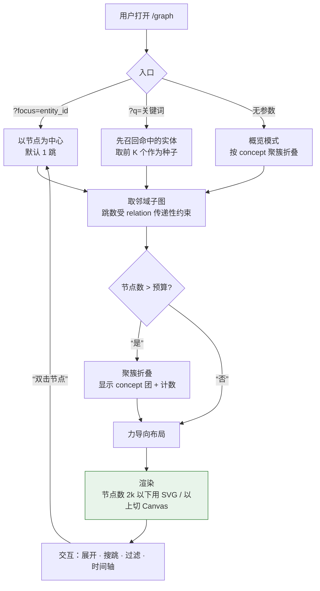

**为什么跳数受限而不是固定 2 跳**：`works_at` 跳两跳就到别的公司，`subtype_of` 跳三跳仍在语义附近。这和 §5 的定向扩展表是**同一张表**——视觉与检索共用一套关系语义，不能各管各的。

### 视觉编码

| 维度 | 编码 | 说明 |
|---|---|---|
| 节点颜色 | `concept` 类型（draft 概念用斜纹） | 一眼看出本体覆盖 |
| 节点大小 | `degree` 或 `importance` | 枢纽实体区识别 |
| 实线边 | 当前有效关系 | |
| 虚线淡边 | `t_invalid` 已失效 | 保留历史，不删除 |
| 蓝色边 | `possiblySame` 待审 | 可直接在图上裁决 |
| 红色描边 | 本次召回命中 | 从召回跳转到图时高亮 |
| 边标签 | 仅悬停显示，默认隐藏 | 避免文字堆叠 |

### 交互清单（首版必须有）

| 交互 | 行为 |
|---|---|
| 点击节点 | 侧栏显示实体卡：各关系、为何生效、它替换了什么、来源 episode |
| 双击节点 | 以它为焦点展开一跳 |
| 搜索框 | 输入走 `Recall`，命中实体作为新焦点 |
| 概念过滤 | 多选 concept 只看关心的类型 |
| 关系过滤 | 按 relation 类型隐藏 |
| 时间轴 | `as_of` 拖拽，失效边实时变淡 |
| 待审裁决 | 对 `possiblySame` 边点「同一」/「不同」，直接调 `Merge` / 写 `negative_SameAs` |
| 复制链接 | 当前视图编码为 URL |

### 工程约束

- **内嵌前端（D11）**：允许使用前端库与构建链（力导向可改用成熟库，不必自己写弹簧-电荷模型），但产物必须通过 `//go:embed` 编进二进制。**运行时依然零外部依赖**——`go install` 下来就是完整可用的，不需要另跑前端服务、不需要 Node。
  - 职责边界：`web/` 目录是构建输入（可以 npm），`web/dist/` 是构建产物并被 embed。**Go 代码只依赖 `web/dist/`，永不 import npm 包。**
  - 代价（自觉接受）：构建产物必须提交进仓库，否则 `go build` 会失败；为此加一个 `make web-check` 校验 `web/dist/` 与 `web/src/` 是否同步，避免“改了源码忘了重建”。
  - 若 CI/本地未装 Node：**已提交的 `web/dist/` 仍然可以构建整个 Go 二进制**，只有想改前端时才需要 Node。这是一条硬要求——不能因为前端而让 `go install` 变得不可用。
- **渲染上限**：SVG ≤ 2k 节点；超过切 Canvas。超预算时**先聚簇折叠**，不降帧。
- **数据接口**：`GET /api/graph?focus=&hops=&as_of=`、`GET /api/entity/{id}`、`POST /api/review`。返回预布局坐标缓存，避免前端抖动。
- **只读优先**：默认只读；唯一的写入口是待审裁决，且必须二次确认。
- **手机可用**：触控拖拽 + 双击展开；布局不依赖 hover。

### 六个页面之间的关系

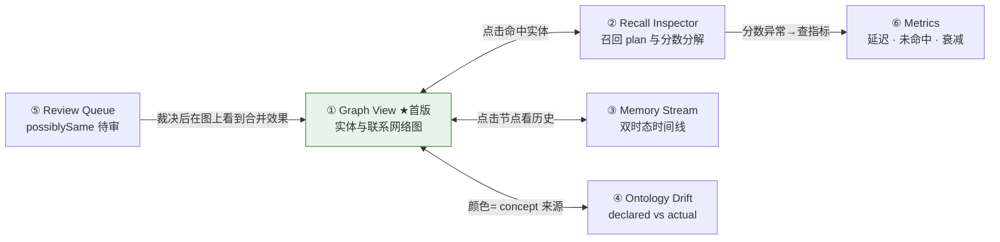

**Graph View 必须是第一个做的。** 它同时是三个东西的入口：本体质量的目测（颜色分布是否合理）、消歧健康度（`possiblySame` 积压是否可见）、以及给使用者的**第一条信任证据**——“它到底记住了什么”这句话，只有图能一句话答完。Recall Inspector 排第二：它是 D1 可被验证的前提。

---

## 10. 三种接入（D5）

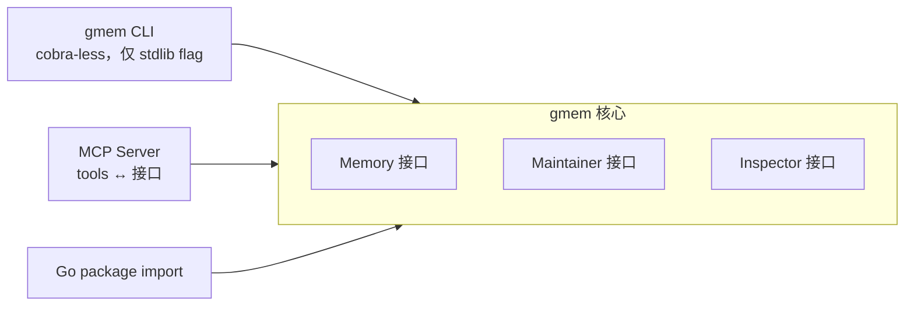

### Go package 主面（对齐五动词 + history）

```go
// 主流对齐：Mem0 的 add/search/get_all/update/delete/history，
// Letta 的 block 读写，MCP 官方 server 的 create/search/read。
type Memory interface {
    Remember(ctx context.Context, req RememberRequest) (RememberResult, error)
    Recall(ctx context.Context, req RecallRequest) (RecallResult, error)
    Get(ctx context.Context, req GetRequest) (MemoryRecord, error)
    List(ctx context.Context, req ListRequest) (ListResult, error)
    Update(ctx context.Context, req UpdateRequest) (UpdateResult, error)
    Forget(ctx context.Context, req ForgetRequest) (ForgetResult, error)
    History(ctx context.Context, req HistoryRequest) (HistoryResult, error)
}

// 维护面：Agent 显式调用，与自动触发共用 op 层。
type Maintainer interface {
    Consolidate(ctx context.Context, req ConsolidateRequest) (ConsolidateResult, error)
    ReviewSimilar(ctx context.Context, req ReviewRequest) (ReviewResult, error)
    Merge(ctx context.Context, req MergeRequest) (MergeResult, error)
    Link(ctx context.Context, req LinkRequest) (LinkResult, error)
    Supersede(ctx context.Context, req SupersedeRequest) (SupersedeResult, error)
    PromoteConcept(ctx context.Context, req PromoteRequest) (PromoteResult, error)
}

// 可解释面
type Inspector interface {
    Explain(ctx context.Context, req ExplainRequest) (ExplainResult, error)
    Diff(ctx context.Context, req DiffRequest) (DiffResult, error)
}

type RecallRequest struct {
    Query    string
    Scope    Scope          // user / agent / project / global
    Kinds    []MemoryKind   // semantic | episodic | procedural | decision
    AsOf     *time.Time     // 双时态回溯
    Budget   Budget
    Lanes    []LaneName     // 留空 = 由 Planner 决定
    Explain  bool
}

type RememberRequest struct {
    Episode   RawEpisode      // 原文，必填
    Scope     Scope
    Inline    *InlineGraph    // 可选：直接带 entities/relations，一次写入并成图
    Extract   ExtractPolicy   // auto | l0_only | skip
}
```

**`InlineGraph` 这一项抄自 CortexDB 的 `memories can carry inline entities/relations so one call stores and graphs them`** —— 对确定知道自己要写什么的调用方（比如结构化写入），跳过抽取能省一次 LLM。

### LLM 注入点（D7）：三种壳的三种接法

同一个 `Extractor` 抽象，在三种接入上的具体形态不同：

```go
// Go package：构造时注入。不注入也能跑，但抽取能力降级。
db, err := gmem.Open(gmem.Config{
    Path:      "brain.db",
    Extractor: gmem.NewLLMExtractor(myLLMClient), // 宿主自己的客户端
    // 或 Extractor: myCustomExtractor{},         // 整段自实现
    // 或 Extractor: gmem.NoopExtractor{},         // 完全离线
})
```

| 接入 | LLM 从哪来 | 未提供时 |
|---|---|---|
| **Go package** | 宿主实现 `LLMClient` 或 `Extractor`，构造时注入 | 降级 L0+L1，`Degraded` 上报 |
| **MCP** | 优先 `GMEM_LLM_*` 配置；**未配置时**退到 `sampling/createMessage`（零密钥） | 降级，`gmem_doctor` 报 degraded |
| **CLI** | `GMEM_LLM_*` 环境变量或 `~/.gmem/config.json` | 降级，首次写入时打印一次告警 |

**一个容易遗漏的设计点**：`Remember` 应该在**调用时**也能临时覆盖抽取策略（`ExtractExtractor` 字段），因为同一个宿主的某些写入（如用户在编辑器里手动 `remember`）期望强抽取，而批量导入期望便宜。

### CLI

| 命令 | 对齐 | 说明 |
|---|---|---|
| `gmem remember -f file --scope user` | Mem0 `add` | 支持 stdin |
| `gmem recall "query" --explain` | Mem0 `search` | `--explain` 打印 plan |
| `gmem get <id>` / `gmem list --scope` | `get` / `get_all` | |
| `gmem forget <id>` / `--scope` | `delete` / `delete_all` | 需二次确认 |
| `gmem history <id>` | Mem0 `history` | before/after |
| `gmem consolidate [--scope]` | — | 手动触发整理 |
| `gmem review` | — | 打印待审池 |
| `gmem serve --inspect` | — | 起可视化（默认落到 `/graph`） |
| `gmem graph --focus <id> --hops 2` | — | 导出当前子图为 JSON / DOT，便于管道处理 |
| `gmem doctor --self-test` | CortexDB `--doctor --self-test` | 环境自检 |
| `gmem migrate --to postgres` | — | 双后端迁移 |

### MCP

主面工具（与五动词一一对应）：

| MCP 工具 | 底层 |
|---|---|
| `gmem_remember` | `Remember` |
| `gmem_recall` | `Recall`（含 `explain` 参数） |
| `gmem_get` / `gmem_list` | `Get` / `List` |
| `gmem_forget` | `Forget` |
| `gmem_history` | `History` |
| `gmem_consolidate` / `gmem_review_similar` / `gmem_merge` / `gmem_link` / `gmem_supersede` | `Maintainer` |

**兼容别名层**（关键的实用决策）：额外提供 `create_entities` / `create_relations` / `add_observations` / `search_nodes` / `open_nodes` / `read_graph`，映射到底层接口。这样**任何已按 MCP 官方 memory server 写好的客户端可以零改动接入**。成本约 100 行，收益是即插即用。

⚠️ 但别名层只提供能力映射，**不承诺与官方 server 的 JSON 存储格式互通**——这一点需要在文档里写死。

另增两个**图专用**工具（与 §9 对齐）：`gmem_graph`（取邻域子图，参数 `focus` / `hops` / `as_of` / `concept`）与 `gmem_review`（列待审 `possiblySame`）。前者让 agent 也能“看”图，而不只是文本召回。

---

## 11. 双后端（D6）

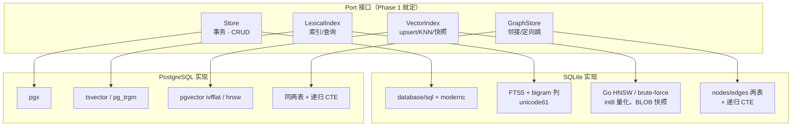

### 三个必须照抄 CortexDB 的做法

1. **编译期注册，不是插件系统**
   > `Compile-time backend registry, not a plugin system (storage is the hot path).`
   存储是热路径，运行期反射注册的代价不值得。

2. **一个测试体，两个数据库，同一答案**
   > `104 opt-in PostgreSQL tests, mostly parity: one test body, both databases, same answer required.`
   **这是保证两个后端不偏移的唯一有效手段。** 写两套测试必然漂移。

3. **图不外包给图数据库**
   > `the graph here is two tables — graph_nodes and graph_edges — in the same database as the vectors... inside one transaction boundary.`

   ⚠️ **实现警告（P0 review 实测）**："同一事务边界"不能靠"各 Port 各自持 `*sql.DB`"实现。当连接池上差点为 1 时，`Tx` 独占唯一连接，回调内再调 `Lexical.Index`/`Vector.Upsert`/`Graph.PutNode` 会**永久挂死**（表现为超时而非报错）。正确做法：`Tx` 必须把 `*sql.Tx` **注入**给后端的各个 Port 副本，使回调内调用落到同一事务；无法注入时必须**快速返回 `ErrTxConflict`**，绝不阻塞。

### Gmem 的具体注意点

| 差异 | SQLite | PostgreSQL |
|---|---|---|
| 占位符 | `?` | `$1` |
| BLOB | `BLOB` | `BYTEA` |
| 向量列 | BLOB + Go 侧解码 | 原生 `vector(n)` + pgvector 算子 |
| 全文 | FTS5 虚表 + bigram | `tsvector`（中文需 `zhparser` 或直接沿用 bigram 列 + `pg_trgm`） |
| 迁移 | — | `gmem migrate --to postgres` 全量导出 + 逐条校验 |

⚠️ **PostgreSQL 的中文全文检索不是免费的**。`tsvector` 默认不理解中文，要么装 `zhparser`/`pg_jieba` 扩展（部署负担），要么沿用 Gmem 自己的 bigram 列 + `pg_trgm`。**建议后者**——保持两侧分词逻辑一致，parity 测试才成立。

### 何时才真的该迁移

不要为"可能增长"提前付代价。触发条件写死：

- 单文件 > 数 GB，或
- 需要多进程/多机并发写入，或
- 向量数 > 20 万且 KNN 延迟超预算

**没触发这三条就用 SQLite。**

---

## 12. 路线图

> ⚠️ **本轮不启动实现（D9）**。下面只是保留下来的实施序列，等设计定稿后再开。

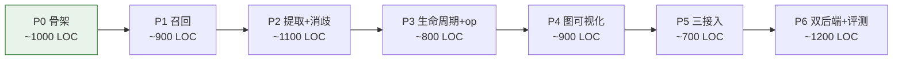

| 阶段 | 交付 | 验收（可测） |
|---|---|---|
| **P0** | schema + 迁移 + Store Port + FTS5 bigram **双侧对称** + RRF 双通道 | 中文 2 字词可命中；bigram 对称性有专项断言测试 |
| **P1** | Concept Aligner + Recall Planner + lane 选择 + `insufficient` + `Explain` | 关系型问句在**无 embedder** 时靠 graph lane 答出；覆盖率不足时返回 `Missing` |
| **P2** | L0/L1 两级 + `LLMClient` / `Extractor` 抽象 + **轻量 tool-calling 循环与五条收敛门禁** + `FakeLLM` + 三区消歧 | 同一实体 5 种写法收敛为 1 节点；灰区不自动合并；`FakeLLM` 下全测试无网络依赖；**“永远返回 tool call” 的序列恰好 3 轮后强制终稿，总调用次数 == MaxTurns+1** |
| **P3** | 双时态失效 + op 层 + 触发器（去抖/阈值/空闲）+ Agent 工具面 | 矛盾写入后旧事实 `as_of` 仍可查；去抖使 N 轮对话只触发 1 次 |
| **P4** | **Graph View 优先** + 五跳式交互 + 内嵌前端（`//go:embed`）+ `gmem serve` | 万级节点库下首屏 < 1s（聚簇折叠生效）；双击展开与待审裁决可用；**未装 Node 的机器上 `go build` 仍成功** |
| **P5** | CLI + MCP（配置优先/sampling 兜底 + 兼容别名）+ `doctor` | MCP 官方 memory client 零改动可连；两路径产出形状一致；均不可用时显式降级 |
| **P6** | PG+pgvector 后端 + `migrate` + parity 测试 + 评测管线 | 一个测试体跑两库答案一致；LongMemEval/LoCoMo 出基线分 |

**总量约 6600 LOC + 等量测试。** 这是估算，不是承诺。

---

## 13. 验收与风险

### 验收口径（建议分两层）

**功能对齐（P0–P5 的门槛）**：

- 五动词 + history + 维护面完整
- 双时态：矛盾失效后可回溯
- 三路融合：无 embedder 时功能不缺失（降级可见）
- **LLM 可注入：`FakeLLM` 跑通全量测试，且 `NoopExtractor` 下不崩溃、降级有上报**
- 召回可解释：任意一次召回能复现 plan
- **图可视化：任意实体能在两跳内找到其邻域，且 `as_of` 能看到边的历史**
- 三接入：同一能力在三种壳上行为一致

**分数指标（P6 的门槛，可后置）**：

- 需要先建评测管线（LongMemEval / LoCoMo / 2WikiMultiHopQA）
- ⚠️ 但要先想清楚一件事：CortexDB 自己的数据显示 **LoCoMo 从 0.493 → 0.495，几乎不动**。如果 Gmem 的目标场景是"记住用户说过什么"，**预期的分数提升空间本来就不大**——这种情况下把目标定成功能对齐更诚实。

### 风险清单

| 风险 | 影响 | 缓解 |
|---|---|---|
| **θ_hi/θ_lo 拍脑袋** | 消歧错判，且错误难恢复 | 灰区不合并 + 用真实数据校准 + `negative_SameAs` |
| **本体漂移** | draft 概念越积越乱 | Ontology Drift 视图 + `Promote` 需人/Agent 显式认证 |
| **中文分词语义弱** | bigram 召回噪音 | 词典（aliases）优先于 bigram；抽取交给 L2 |
| **modernc 编译慢/体积大** | 交付体验 | 已知代价，接受；`go install` 无需 C 编译器是收益 |
| **双后端漂移** | PG 行为与 SQLite 不同 | parity 测试：一个测试体两个库 |
| **宿主不实现 LLMClient** | 抽取降级、体验变差 | 降级**必须可见**（`Degraded` + doctor）；`InlineGraph` 让结构化写入绕过抽取 |
| **tool-calling 死循环** | 成本失控、写入卡死 | 五条收敛门禁（MaxTurns=3 / token 预算 / 同 query 重复 / 无进展 / 墙钟超时）+ 工具面无写操作 + `hops` 固定 1 |
| **抽取提示与宿主模型不匹配** | JSON 解析失败率高 | schema 可覆盖 + 修复式重试 1 次 + 失败入 `Degraded` 不抛错 |
| **两条 LLM 路径行为漂移** | 同一片段走配置与走 sampling 结果不同 | 共用同一个 `ExtractResult` 校验器；parity 测试以 `FakeLLM` 跑两路径同一断言 |
| **sampling 弹窗过多** | 写入体验崩 | 配置优先；sampling 只在未配置时启用；批量合为一次弹窗，单条直接降级 |
| **大量节点图渲染卡顿** | 可视化不可用 | 不渲染全图：聚簇折叠 + 节点预算 + SVG/Canvas 分档 |
| **前端产物与源码不同步** | `go build` 拿到旧前端 | `make web-check` 校验 `web/dist` 与 `web/src` 一致性；构建产物必须提交 |
| **未装 Node 导致构建失败** | 违背“运行时零依赖” | `web/dist/` 提交进仓库，Go 构建只读 embed 产物；只有改前端才需 Node |

### 证据边界

- 上文所有因果与取舍推理，来自前五轮调研的公开文档：CortexDB `llms-full.txt`（含 `never imports an LLM SDK`、`serve_graph_3d` 视图即 URL 两条直接引文）、NVIDIA Auto-Ontology README（Answer 五步中 Join 不调模型）、Zep/Graphiti 论文与 `search_config.py` 枚举、Mem0 v3 迁移文档、LangMem 文档、**MCP 官方 spec 的 sampling 章节**、modernc/FTS5 的第三方材料。
- **LOC 估算、0.92/0.72 阈值、lane 权重表、跳数规则表、图渲染节点上限 2k，全部是待校准的设计起点，不是实测结论。**
- 图上所有机制我**没有实现过任何一行**，也没有在真实数据上验证过效果。CortexDB / Auto-Ontology 的性能数字均为项目自报，无第三方复现。
- **MCP sampling 的定位是“未配置时的兜底”**：spec 确实提供了 `sampling/createMessage` 且明言无需服务端密钥，但“配置优先还是 sampling 优先”这个取舍官方未做推荐；本文选配置优先，理由是显式配置代表使用者已做出成本与合规选择。
- **tool-calling 的三个只读工具（`lookup_entity` / `neighbors` / `search_memories`）与五条收敛门禁的具体阈值，是从“防死循环”推导的设计，没有实测。** MaxTurns=3 这个数尤其需要根据真实抽取质量与成本重新校准。


